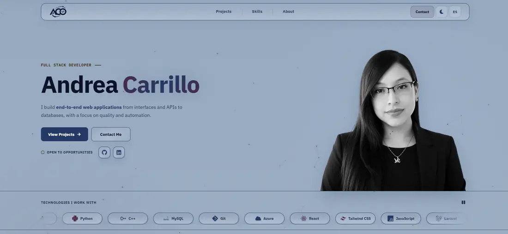

# Andrea Carrillo Oporto · Full Stack Developer

Bilingual professional portfolio showcasing web applications, backend development, and distributed systems.

**[Live portfolio](https://andreacarrillo-portafolio.netlify.app/)** · [GitHub](https://github.com/AndreaCarrilloOp) · [LinkedIn](https://www.linkedin.com/in/andrea-carrillo-vlk/)

## Preview

| Light mode | Dark mode |
| :---: | :---: |
|  |  |

## Highlights

- **Selected projects:** Distributed Library Platform, SCRABBLE (C++ / WebAssembly), Bookstore RabbitMQ, and Huellita PetShop.
- **Responsive and bilingual:** mobile-friendly layout, light/dark themes, English and Spanish content.
- **Accessibility-focused:** semantic HTML, keyboard navigation, visible focus states, and reduced-motion support.
- **Discoverability:** Open Graph previews, structured data, and search engine metadata.

## Tech stack

**React 19 · Vite 6 · JavaScript · CSS · i18next · React Icons**

Built with **pnpm** and deployed on **Netlify**. Quality checks use ESLint, static tests, and automated browser accessibility checks through GitHub Actions.

## Local development

Requires **Node.js 24** and **pnpm 9.15.0**.

```bash
corepack enable
pnpm install --frozen-lockfile
pnpm dev
```

To check and build the project:

```bash
pnpm check
pnpm build
pnpm preview
```

Netlify builds with `pnpm build` and publishes the `dist/` directory. Deployment settings are in [`netlify.toml`](netlify.toml).

---

Designed and developed by **Andrea Carrillo Oporto**.
